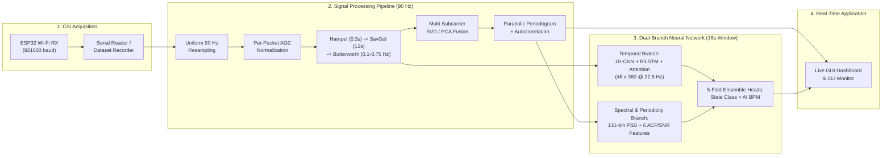

# Contactless Respiration Monitoring via ESP32 Wi-Fi CSI

A dual-pipeline **Digital Signal Processing (PhaseBeat / Multi-Subcarrier PCA)** and **Deep Learning (Dual-Branch 1D-CNN + BiLSTM + Spectral Network)** system for contactless human breathing rate estimation and apnea detection using commodity **ESP32** Wi-Fi Channel State Information (CSI).

---

## Key Features

- **Device-Free & Off-LOS Capable:** Extracts subtle chest displacements ($2\text{--}5\text{ mm}$) in indoor multipath environments without requiring the subject to lie strictly on the TX–RX line-of-sight (LOS).
- **Per-Packet AGC Normalization & SVD/PCA Subcarrier Fusion:** Cancels ESP32 automatic gain control (AGC) step artifacts and fuses 46–52 active OFDM subcarriers to overcome Fresnel zone blind spots.
- **High-Resolution Spectral & Autocorrelation Estimator:** Combines a Hann-windowed periodogram (with parabolic log-power peak interpolation, $<0.1\text{ BPM}$ resolution) and autocorrelation (ACF) periodicity verification.
- **Dual-Branch Multi-Task Deep Learning:** Jointly classifies 4 respiratory states (**Apnea, Slow, Normal, Fast**) and regresses continuous breathing rate (**BPM**) over 16-second online-consistent sliding windows.
- **Real-Time Interactive GUI Dashboard:** Live Matplotlib dashboard displaying cleaned respiration waveforms, detected inhalation peaks, power spectral density (PSD), DSP BPM estimates, and AI state predictions side-by-side.

---

## System Architecture



---

## Repository Structure

```text
process_csi_data/
├── config/
│   └── settings.py                  # Global paths, serial port (COM3, 921600), and DSP constants
├── utils/
│   └── data_loader.py               # Validated NPZ recording loader (CSIRecording dataclass)
├── 01_data_collection/
│   ├── serial_reader.py             # Real-time ESP32 CSI serial parser (64 complex I/Q subcarriers)
│   └── record_dataset.py            # Interactive CLI dataset recorder with visual terminal metronome
├── 02_phasebeat_dsp/
│   ├── respiration_pipeline.py      # v2 Multi-subcarrier pipeline (AGC norm, PCA fusion, Parabolic FFT + ACF)
│   ├── phasebeat_core.py            # Classic single-channel PhaseBeat preprocessing & MAD selector
│   ├── filters/                     # Hampel spike removal, Savitzky-Golay detrend, Butterworth, Phase sanitizer
│   └── estimation/                  # Welch FFT & time-domain peak-counting estimators
├── 03_realtime_app/
│   ├── stream_source.py             # LiveSerialSource (USB COM) & SimulatedFileSource (NPZ playback)
│   ├── realtime_engine.py           # Threaded sliding-window buffer + dual DSP & AI inference engine
│   ├── app_gui.py                   # Real-time Matplotlib dashboard (Waveform, PSD, DSP BPM, AI State)
│   └── app_cli.py                   # Headless terminal monitor
├── 04_ai_model/
│   ├── dataset_prep.py              # Online-consistent 16s sliding-window feature extractor
│   ├── models.py                    # Dual-branch CSI_RespirationNet (1D-CNN + BiLSTM + Spectral MLP)
│   ├── train.py                     # 5-Fold StratifiedGroupKFold training & evaluation pipeline
│   └── inference.py                 # Real-time 5-fold ensemble inference wrapper
├── document/                        # Technical documentation, architectural specs & academic literature
│   ├── 05_documentation_summary/    # Comprehensive technical package (architecture, research summary, plots)
│   │   ├── codebase_architecture.md # Full module breakdown, classes, dataflows & tensor shapes
│   │   ├── research_work_and_preliminary_evaluation.md # 39KB technical report: physics, DSP, AI & benchmarks
│   │   └── images/                  # 5-fold confusion matrix & loss curves
│   ├── PhaseBeat_ACMHealth20.pdf    # Baseline PhaseBeat paper (English)
│   ├── PhaseBeat_ACMHealth20_vietnamese.pdf # Vietnamese translation of PhaseBeat
│   ├── ESPIDF_tool_for_CSI based_device.pdf # ESP32 CSI packet structure & tool reference
│   ├── Awsome_wifi_sensing_doc.md   # Curated list of Wi-Fi CSI sensing papers
│   ├── FarSense_Fresnel_Respiration_MobiCom19_arXiv1907.03994.pdf # Fresnel zone blind spots (MobiCom'19)
│   ├── SA_WiSense_ESP32_SingleAntenna_BlindSpotFree_Respiration_arXiv2507.17623.pdf # Blind-spot-free sensing
│   ├── PulseFi_ESP32_CSI_LSTM_Apnea_Cardiopulmonary_arXiv2510.24744.pdf # Deep learning LSTM apnea sensing
│   └── SenseFi_DeepLearning_WiFi_CSI_Benchmark_arXiv2207.07859.pdf # CSI deep learning benchmark dataset
└── data/
    ├── raw/                         # Labeled raw CSI recordings (*.npz)
    ├── processed/                   # Extracted training tensors & evaluation plots (*.npz, *.png)
    └── weights/                     # Trained PyTorch checkpoint (best_csi_model.pt)
```

---

## Documentation & Research Package

Comprehensive technical documentation, theoretical derivations, and research papers are organized under [`document/`](file:///D:/Master/Luanvan/process_csi_data/document/):

- 📘 [**Codebase Architecture & Module Reference**](file:///D:/Master/Luanvan/process_csi_data/document/05_documentation_summary/codebase_architecture.md): Complete module-by-module breakdown, class APIs, dataflow sequence, and tensor contracts across `01_data_collection`, `02_phasebeat_dsp`, `03_realtime_app`, and `04_ai_model`.
- 🔬 [**Research Work, Methodology & Evaluation Report**](file:///D:/Master/Luanvan/process_csi_data/document/05_documentation_summary/research_work_and_preliminary_evaluation.md): In-depth 39KB technical report detailing the physics of CSI sensing, Fresnel zone geometry, per-packet AGC normalization, multi-subcarrier SVD/PCA fusion, AI model design evolution (v1 vs v2), 5-Fold cross-validation metrics, and analysis of real-time testing jitter.
- 📚 [**Academic Papers & Technical References**](file:///D:/Master/Luanvan/process_csi_data/document/): 8 papers covering CSI breathing sensing, ESP32 packet internals, Fresnel zone blind-spot mitigation, and deep learning architectures.

---

## Quickstart

### 1. Install Dependencies

```powershell
pip install numpy scipy matplotlib pyserial torch scikit-learn
```

### 2. Record Labeled CSI Dataset (with Visual Metronome)

```powershell
python 01_data_collection/record_dataset.py --port COM3
```
Supports preset scenarios: **Apnea ($0\text{ BPM}$)**, **Slow ($10\text{ BPM}$)**, **Normal ($16\text{ BPM}$)**, and **Fast ($24\text{ BPM}$)** with a real-time terminal breathing guide.

### 3. Prepare Dataset & Train AI Model (5-Fold Group Cross-Validation)

```powershell
python 04_ai_model/dataset_prep.py
python 04_ai_model/train.py
```
Outputs the 5-fold ensemble checkpoint to `data/weights/best_csi_model.pt` and evaluation figures to `data/processed/`.

### 4. Launch Real-Time Monitoring Dashboard

**Live ESP32 Serial Stream:**
```powershell
python 03_realtime_app/app_gui.py --source live --port COM3
```

**Simulated Playback from Recorded `.npz` File:**
```powershell
python 03_realtime_app/app_gui.py --source sim --file normal_16bpm_20261105_023853.npz
python 03_realtime_app/app_gui.py --source sim --file apnea_0bpm_20261105_022627.npz
```

**Dashboard Hotkeys:**
| Key | Action |
|---|---|
| `R` | Start / stop recording live CSI packets to `data/raw/rec_<timestamp>.npz` |
| `M` | Toggle between `AMPLITUDE` and `PHASE` processing modes |
| `C` | Recalibrate automatic subcarrier / PCA selection |
| `[` / `]` | Manually step through individual subcarrier indices (`SC 0..63`) |
| `Q` | Close dashboard and release serial port |

---

## Benchmark Summary (21 Labeled Recordings, 20s Sliding Windows)

| Metric | Classic PhaseBeat (v1) | Upgraded Pipeline (v2) |
|---|---|---|
| **DSP Breathing MAE — Slow ($10\text{ BPM}$)** | $1.04\text{ BPM}$ | **$0.86\text{--}1.02\text{ BPM}$** |
| **DSP Breathing MAE — Normal ($16\text{ BPM}$)** | $3.16\text{ BPM}$ | **$1.05\text{--}1.69\text{ BPM}$** |
| **DSP Breathing MAE — Fast ($24\text{ BPM}$)** | $2.60\text{ BPM}$ | **$1.87\text{--}2.05\text{ BPM}$** |
| **DSP Overall Breathing MAE** | $2.26\text{ BPM}$ ($75.1\% \le 2\text{ BPM}$) | **$1.32\text{ BPM}$ ($86.7\% \le 2\text{ BPM}$)** |
| **AI 5-Fold Unseen-Session Accuracy** | $48.8\%$ (Macro F1 = $0.461$) | **$90.6\%$ (Macro F1 = $0.917$)** |
| **AI Real-Time Sliding-Window Accuracy** | $44.4\%$ | **$94.2\%$** |
| **Apnea Detection Recall** | $0.0\%$ (DSP alone) | **$96.7\%\text{ (Unseen CV)} \text{ / } 100.0\%\text{ (Ensemble)}$** |
