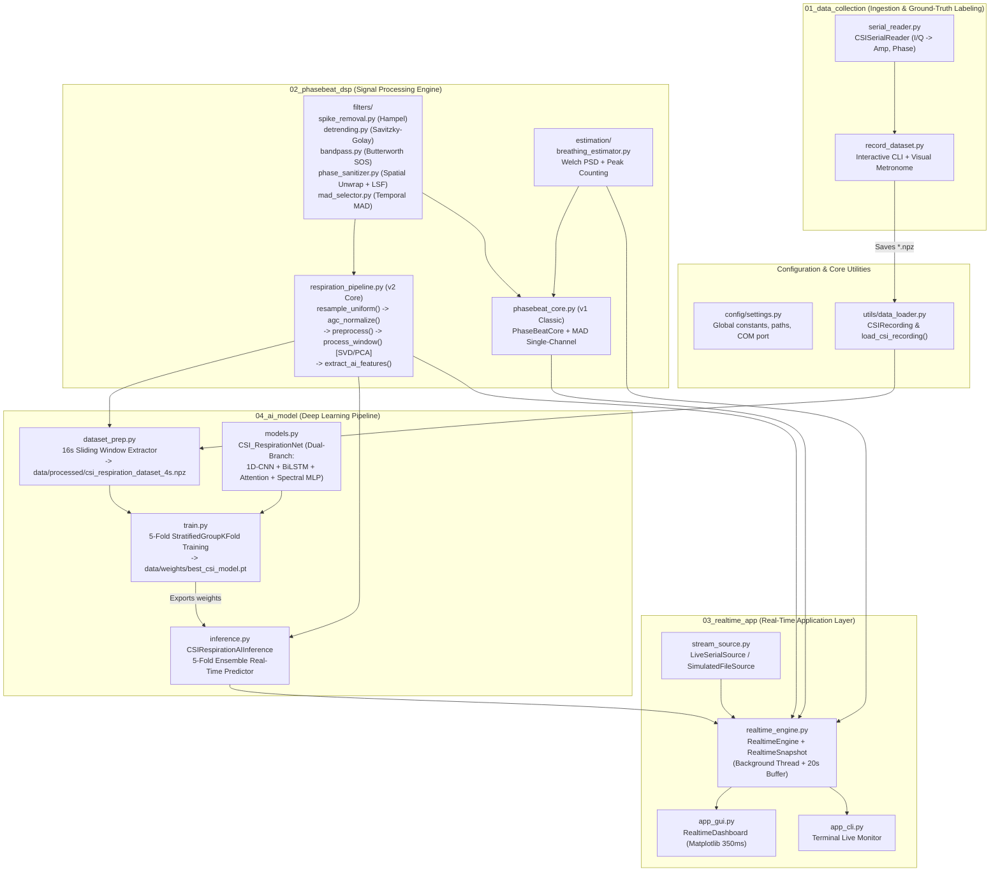

# Codebase Architecture & Module Reference (`process_csi_data`)

Tài liệu này mô tả chi tiết cấu trúc mã nguồn, luồng dữ liệu (Dataflow), các lớp (Classes), hàm (Functions), định dạng Tensor và mối liên kết giữa 4 phân hệ chính trong repository `D:\Master\Luanvan\process_csi_data\`.

---

## 1. Sơ Đồ Kiến Trúc Tổng Thể (High-Level Architecture)



---

## 2. Cấu Trúc Thư Mục Chi Tiết (Directory Tree)

```text
D:\Master\Luanvan\process_csi_data\
│
├── README.md                                  # Tài liệu hiển thị chính trên GitHub
├── config/
│   ├── __init__.py
│   └── settings.py                            # Cấu hình cổng Serial, tần số lấy mẫu, đường dẫn data
├── utils/
│   ├── __init__.py
│   └── data_loader.py                         # Đọc và kiểm tra tính hợp lệ của file .npz (CSIRecording)
│
├── 01_data_collection/                        # [PHÂN HỆ 1] THU THẬP DỮ LIỆU & ĐÁNH NHÃN
│   ├── serial_reader.py                       # Đọc luồng UART từ ESP32, tách 64 cặp I/Q
│   └── record_dataset.py                      # Giao diện thu mẫu có máy đếm nhịp (Metronome)
│
├── 02_phasebeat_dsp/                          # [PHÂN HỆ 2] XỬ LÝ TÍN HIỆU SỐ (DSP)
│   ├── respiration_pipeline.py                # [CORE v2] Resample 90Hz, Chuẩn hóa AGC, SVD/PCA, Parabolic FFT + ACF
│   ├── phasebeat_core.py                      # [CORE v1] Pipeline PhaseBeat cổ điển chọn 1 kênh bằng MAD
│   ├── filters/
│   │   ├── __init__.py
│   │   ├── spike_removal.py                   # Bộ lọc Hampel khử gai nhọn (cửa sổ 0.3s, 3-sigma)
│   │   ├── detrending.py                      # Khử trôi nền Savitzky-Golay (cửa sổ 12.0s, bậc 2)
│   │   ├── bandpass.py                        # Lọc thông dải Butterworth zero-phase (sosfiltfilt)
│   │   ├── mad_selector.py                    # Xếp hạng kênh phụ theo Median Absolute Deviation
│   │   └── phase_sanitizer.py                 # Khử độ lệch pha tuyến tính CFO/STO trên từng gói tin
│   └── estimation/
│       ├── __init__.py
│       └── breathing_estimator.py             # Ước lượng BPM kết hợp Welch PSD và đếm đỉnh miền thời gian
│
├── 03_realtime_app/                           # [PHÂN HỆ 3] ỨNG DỤNG GIÁM SÁT THỜI GIAN THỰC
│   ├── __init__.py
│   ├── stream_source.py                       # Trừu tượng hóa nguồn dữ liệu: LiveSerialSource & SimulatedFileSource
│   ├── realtime_engine.py                     # Quản lý luồng đọc ngầm, bộ đệm trượt 20s, hợp nhất DSP + AI
│   ├── app_gui.py                             # Giao diện đồ họa Matplotlib 350ms/frame
│   └── app_cli.py                             # Giao diện giám sát trên dòng lệnh
│
├── 04_ai_model/                               # [PHÂN HỆ 4] MẠNG NƠ-RON HỌC SÂU ĐA NHIỆM
│   ├── dataset_prep.py                        # Cắt cửa sổ 16s đồng nhất với realtime, lưu tensor huấn luyện
│   ├── models.py                              # Kiến trúc mạng Dual-Branch CSI_RespirationNet
│   ├── train.py                               # Huấn luyện & kiểm định chéo 5-Fold StratifiedGroupKFold
│   └── inference.py                           # Bộ suy luận online sử dụng tổ hợp 5-Fold Ensemble
│
├── data/                                      # KHO LƯU TRỮ DỮ LIỆU & TRỌNG SỐ
│   ├── raw/                                   # Chứa 21 file mẫu có nhãn (*_202611*.npz) và các file test
│   ├── processed/                             # Chứa csi_respiration_dataset_4s.npz và ảnh đánh giá (.png)
│   └── weights/                               # Chứa checkpoint mô hình tốt nhất (best_csi_model.pt)
│
└── 05_documentation_summary/                  # [TÀI LIỆU ĐÀO TẠO & BÁO CÁO - KHÔNG COMMIT]
    ├── README.md                              # Trang chỉ mục của bộ tài liệu tổng hợp
    ├── codebase_architecture.md               # Tài liệu kiến trúc mã nguồn (file này)
    ├── research_work_and_preliminary_evaluation.md  # Báo cáo chi tiết toàn bộ công việc, thuật toán & kết quả
    ├── images/                                # Ảnh Confusion Matrix và Training Curves
    └── document/                              # Tài liệu gốc từ doc/ + 4 bài báo khoa học PDF tải thêm
```

---

## 3. Phân Tích Chi Tiết Từng Phân Hệ (Module-by-Module Breakdown)

### 3.1. Cấu Hình & Tiện Ích Chung (`config/` & `utils/`)

#### [`config/settings.py`](file:///D:/Master/Luanvan/process_csi_data/config/settings.py)
* **Vai trò:** Tập trung toàn bộ hằng số cấu hình của hệ thống.
* **Các tham số chính:**
  * `PROJECT_ROOT`, `DATA_DIR`, `RAW_DATA_DIR` (`data/raw/`).
  * `SERIAL_PORT = "COM3"`, `BAUD_RATE = 921600`.
  * `NUM_SUBCARRIERS = 64` (chuẩn 64 điểm FFT của ESP32 HT20).

#### [`utils/data_loader.py`](file:///D:/Master/Luanvan/process_csi_data/utils/data_loader.py)
* **Dataclass `CSIRecording`:** Đóng gói một bản ghi CSI đã được kiểm tra tính toàn vẹn:
  * `amplitudes`: `NDArray[float64]` kích thước `(N, 64)`.
  * `phases`: `NDArray[float64] | None` kích thước `(N, 64)`.
  * `timestamps`: `NDArray[float64]` kích thước `(N,)`, kèm thuộc tính `relative_time` chuẩn hóa về mốc `0.0s`.
  * `fs`: Tần số lấy mẫu trung bình thực tế $(N-1)/(t_{end} - t_{start})$.
* **Hàm `load_csi_recording(file_name_or_path)`:** Tự động tìm kiếm file trong `data/raw/`, kiểm tra chiều mảng, kiểm tra giá trị hữu hạn (`np.isfinite`) và tính đơn điệu của thời gian.

---

### 3.2. Phân Hệ 1: Thu Thập Dữ Liệu (`01_data_collection/`)

#### [`01_data_collection/serial_reader.py`](file:///D:/Master/Luanvan/process_csi_data/01_data_collection/serial_reader.py)
* **Class `CSISerialReader`:**
  * Mở kết nối UART tới ESP32 ở tốc độ `921600 baud`.
  * Đọc từng dòng chuỗi văn bản có chứa từ khóa `"CSI_DATA"`.
  * Dùng biểu thức chính quy tách 128 số nguyên cuối cùng tương ứng với 64 cặp $(I_k, Q_k)$:
    $$\text{Amplitude}_k = \sqrt{I_k^2 + Q_k^2}, \quad \text{Phase}_k = \text{atan2}(Q_k, I_k)$$

#### [`01_data_collection/record_dataset.py`](file:///D:/Master/Luanvan/process_csi_data/01_data_collection/record_dataset.py)
* **Vai trò:** Công cụ CLI tương tác dùng để thu thập tập dữ liệu có nhãn chuẩn (Ground Truth).
* **Cơ chế nổi bật:**
  * Tích hợp **Visual Terminal Metronome** (thanh tiến trình HÍT VÀO / THỞ RA theo chu kỳ thời gian thực ngay trên màn hình console) để người đo thở đúng nhịp mục tiêu:
    * `apnea`: $0\text{ BPM}$ (nín thở, mặc định 25–35s).
    * `slow`: $10\text{ BPM}$ (chu kỳ $6.0\text{s/nhịp}$, thu 50s).
    * `normal`: $16\text{ BPM}$ (chu kỳ $3.75\text{s/nhịp}$, thu 50s).
    * `fast`: $24\text{ BPM}$ (chu kỳ $2.5\text{s/nhịp}$, thu 50s).
  * Lưu trữ file `.npz` vào `data/raw/` với đầy đủ metadata: `amps`, `phases`, `times`, `label_class`, `class_id`, `target_bpm`, `duration`, `actual_fs`, `subject`, `created_at`.

---

### 3.3. Phân Hệ 2: Xử Lý Tín Hiệu Số (`02_phasebeat_dsp/`)

#### [`02_phasebeat_dsp/respiration_pipeline.py`](file:///D:/Master/Luanvan/process_csi_data/02_phasebeat_dsp/respiration_pipeline.py) *(Pipeline Thế Hệ 2 - Đang dùng chính)*
Đây là lõi xử lý tín hiệu đa kênh hiện đại nhất của dự án, giải quyết bài toán người ngồi lệch khỏi đường thẳng nối 2 ESP32 (Off-LOS):
* **`ACTIVE_SUBCARRIERS_64`** (52 kênh, bỏ guard 0–5, 59–63 và DC 32) & **`ACTIVE_SUBCARRIERS_46`** (46 kênh dữ liệu thuần túy, bỏ thêm 6 kênh pilot 13, 21, 29, 37, 45, 53).
* **`resample_uniform(times, *arrays, fs=90.0)`:** Nội suy tuyến tính chuỗi gói tin không đều của ESP32 (dao động 72–102 Hz) về lưới thời gian đều đặn tuyệt đối $90.0\text{ Hz}$ (có khử trùng lặp timestamp bằng `np.unique`).
* **`agc_normalize(amps)`:** Chia mỗi gói tin cho giá trị biên độ trung bình của các subcarrier hoạt động trong cùng gói đó. Triệt tiêu hoàn toàn bước nhảy khuếch đại tự động (AGC) của chip ESP32.
* **`preprocess(x, fs, lowcut=0.1, highcut=0.75, detrend_seconds=12.0)`:**
  1. `remove_spikes`: Lọc Hampel cửa sổ $0.3\text{s}$.
  2. `savgol_filter`: Khử trôi nền đa thức bậc 2 cửa sổ $12.0\text{s}$ (loại bỏ hoàn toàn phản xạ tĩnh từ tường/đồ vật).
  3. `sosfiltfilt`: Lọc thông dải Butterworth bậc 2 zero-phase trong dải thở $0.1\text{--}0.75\text{ Hz}$ ($6\text{--}45\text{ BPM}$).
* **`process_window(amps, fs=90.0, n_components=3)`:**
  * Chuẩn hóa z-score từng kênh rồi phân rã **SVD/PCA** (`np.linalg.svd`) để gom năng lượng hô hấp trên tất cả các kênh phụ.
  * Tính tỉ số SNR trong dải thở cho 3 thành phần chính đầu tiên ($PC_1, PC_2, PC_3$) và chọn thành phần có SNR cao nhất.
  * Tính nhịp thở từ phổ (`spectral_bpm`: cửa sổ Hann + FFT zero-padded $N_{fft}=16384$ + **nội suy đỉnh Parabol** trên thang log-power) và hàm tự tương quan (`acf_bpm`). Nếu 2 phương pháp chênh nhau $\le 3.0\text{ BPM}$ thì lấy trung bình cộng.
  * Trả về đối tượng `RespirationResult`.
* **`extract_ai_features(raw_amps, fs=90.0, window_sec=16.0)`:**
  * Hàm dùng chung **100%** cho cả bước chuẩn bị dữ liệu huấn luyện (`dataset_prep.py`) và bước suy luận thời gian thực (`inference.py`).
  * Từ cửa sổ $16.0\text{s}$ ($1440$ mẫu ở $90\text{ Hz}$), trả về 3 tensor:
    1. `x_wave`: `(46, 360)` — ma trận 46 kênh đã lọc, giảm mẫu 4 lần về $22.5\text{ Hz}$.
    2. `x_spec`: `(131,)` — phổ mật độ công suất (PSD) chuẩn hóa trong dải $0.08\text{--}0.80\text{ Hz}$.
    3. `x_aux`: `(6,)` — vector đặc trưng vật lý gồm `[bpm/30, spec_bpm/30, acf_bpm/30, snr/10, acf_peak, median_std*100]`.

#### [`02_phasebeat_dsp/phasebeat_core.py`](file:///D:/Master/Luanvan/process_csi_data/02_phasebeat_dsp/phasebeat_core.py) & `filters/` & `estimation/`
* Giữ vai trò pipeline cơ sở (Baseline v1) và phục vụ chế độ xem từng kênh phụ thủ công (`Manual Subcarrier Mode`) hoặc chế độ Pha (`Phase Mode`) trên GUI.
* Trong [`filters/phase_sanitizer.py`](file:///D:/Master/Luanvan/process_csi_data/02_phasebeat_dsp/filters/phase_sanitizer.py): Đã sửa lỗi quan trọng bằng cách chỉ thực hiện `np.unwrap(phase, axis=1)` theo chiều không gian subcarrier trên từng gói rồi khớp tuyến tính khử CFO/STO, thay vì unwrap theo chiều thời gian trước.

---

### 3.4. Phân Hệ 4: Mô Hình Học Sâu (`04_ai_model/`)

#### [`04_ai_model/dataset_prep.py`](file:///D:/Master/Luanvan/process_csi_data/04_ai_model/dataset_prep.py)
* Duyệt toàn bộ 21 file có nhãn trong `data/raw/*_202611*.npz`.
* Resample từng file về $90.0\text{ Hz}$, trượt cửa sổ độ dài $16.0\text{s}$ với bước trượt (stride) $2.0\text{s}$.
* Gọi `extract_ai_features` trên từng cửa sổ thô (đảm bảo hiệu ứng biên của bộ lọc giống hệt lúc chạy realtime).
* Xuất ra `data/processed/csi_respiration_dataset_4s.npz` chứa 286 mẫu với các trường: `X` `(286, 46, 360)`, `X_spec` `(286, 131)`, `X_aux` `(286, 6)`, `y_class` `(286,)`, `y_bpm` `(286,)`, `groups` `(286,)` (chỉ số file từ 0..20).

#### [`04_ai_model/models.py`](file:///D:/Master/Luanvan/process_csi_data/04_ai_model/models.py)
* **Class `CSI_RespirationNet` (Dual-Branch Multi-Task Architecture):**
  * **Chuẩn hóa đầu vào:** Chuẩn hóa toàn cục trên toàn bộ cửa sổ `(46, 360)` (`mean/std over dim=(-2, -1)`), giúp bảo toàn tương quan biên độ giữa các kênh.
  * **Nhánh 1 — Temporal Spatio-Sequential (`temp_conv` + `lstm` + `attention_pool`):**
    * `Conv1d(46 -> 32, k=7) -> BatchNorm1d -> LeakyReLU -> MaxPool1d(3) -> Dropout(0.35)` (360 $\to$ 120 bước).
    * `Conv1d(32 -> 48, k=5) -> BatchNorm1d -> LeakyReLU -> MaxPool1d(3) -> Dropout(0.35)` (120 $\to$ 40 bước).
    * `BiLSTM(input=48, hidden=32, bidirectional=True)` $\to$ đầu ra `(B, 40, 64)`.
    * Kết hợp trung bình chuỗi và `AttentionPooling(64)` $\to$ vector thời gian `t_feat` `(B, 64)`.
  * **Nhánh 2 — Spectral & Periodicity Encoder (`spec_fc`):**
    * Ghép `x_spec (131)` và `x_aux (6)` thành vector `137` chiều.
    * `Linear(137 -> 64) -> LayerNorm -> LeakyReLU -> Dropout(0.35) -> Linear(64 -> 48) -> LeakyReLU` $\to$ vector phổ `s_feat` `(B, 48)`.
  * **Hai đầu ra Đa nhiệm (Multi-Task Heads):**
    * Ghép `fused = concat(t_feat, s_feat)` `(B, 112)`.
    * `classifier`: `Linear(112 -> 48) -> LeakyReLU -> Dropout -> Linear(48 -> 4)` (4 lớp: `apnea`, `slow`, `normal`, `fast`).
    * `regressor`: `Linear(112 -> 32) -> LeakyReLU -> Linear(32 -> 1) * 30.0` (dự đoán nhịp thở liên tục BPM).

#### [`04_ai_model/train.py`](file:///D:/Master/Luanvan/process_csi_data/04_ai_model/train.py)
* Sử dụng **`StratifiedGroupKFold(n_splits=5)`** theo mảng `groups` (mỗi file thu âm là một group độc lập).
* Áp dụng **Class-Weighted CrossEntropyLoss** + $1.5 \times \text{SmoothL1Loss}$ và tăng cường dữ liệu (Subcarrier Dropout 15% + Gaussian Noise).
* Lưu cả 5 bộ trọng số của 5 Fold (`ensemble_state_dicts`) vào `data/weights/best_csi_model.pt` và vẽ biểu đồ ra `data/processed/confusion_matrix.png`, `data/processed/training_curves.png`.

#### [`04_ai_model/inference.py`](file:///D:/Master/Luanvan/process_csi_data/04_ai_model/inference.py)
* **Class `CSIRespirationAIInference`:**
  * Nạp tổ hợp 5 mô hình từ `data/weights/best_csi_model.pt`.
  * Khi nhận mảng biên độ đã resample đều $90\text{ Hz}$ từ `RealtimeEngine`, gọi `extract_ai_features`, chạy qua cả 5 mô hình và lấy trung bình xác suất Softmax cùng trung bình BPM.

---

### 3.5. Phân Hệ 3: Ứng Dụng Thời Gian Thực (`03_realtime_app/`)

#### [`03_realtime_app/stream_source.py`](file:///D:/Master/Luanvan/process_csi_data/03_realtime_app/stream_source.py)
* **`LiveSerialSource`:** Đọc gói CSI trực tiếp từ cổng USB Serial của ESP32.
* **`SimulatedFileSource`:** Phát lại bất kỳ file `.npz` nào trong `data/raw/` theo đúng tốc độ thời gian thực của bản ghi gốc (có hỗ trợ lặp vô tận `loop=True` với trục thời gian đơn điệu liên tục).

#### [`03_realtime_app/realtime_engine.py`](file:///D:/Master/Luanvan/process_csi_data/03_realtime_app/realtime_engine.py)
* **Class `RealtimeEngine`:**
  * Chạy một luồng ngầm (`_receiver_loop`) liên tục nạp gói tin vào `deque` trượt có độ dài `window_size_sec = 20.0s`.
  * Mỗi khi giao diện gọi `compute_snapshot()` (350ms/lần):
    1. Kiểm tra thời lượng buffer $\ge \text{min\_window\_sec}$ ($10.0\text{s}$).
    2. Gọi `resample_uniform` đưa buffer về lưới $90.0\text{ Hz}$.
    3. Gọi `self.ai_inference.predict_window(uniform_amps, 90.0)` để lấy dự đoán AI (`ai_class`, `ai_confidence`, `ai_bpm`).
    4. Gọi `process_window(uniform_amps, 90.0)` để lấy kết quả DSP (`waveform`, `bpm`, `spec_bpm`, `acf_bpm`, `snr`, `acf_peak`).
    5. Hợp nhất quyết định **Apnea vs. Breathing** có bộ đếm chống nhiễu (debounce 3 frames) và làm mượt BPM bằng trung vị trượt (`_bpm_history`).
    6. Đóng gói toàn bộ vào dataclass `RealtimeSnapshot`.
